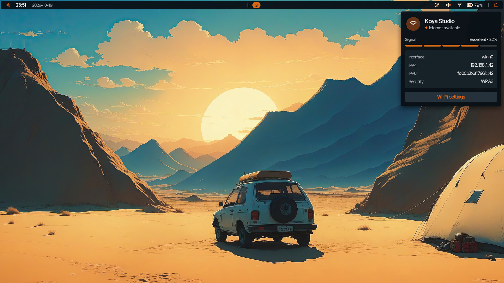

# Koya Shell Live

<p align="center">
  
</p>

[Koya Shell](https://github.com/Omnomios/koya-bar), a desktop shell built on
Koya, for Hyprland and Arch, on a USB stick. Boot it and you're on the full
desktop, running from the stick. Nothing on the computer is touched, and
nothing you do survives a shutdown. Try it out without sacrificing a machine
to it.

It's one shell from the login screen to the lock screen, with one theme across
all of it, and the visual polish of a web stack without the cruft. There's no
browser underneath; Koya draws it on the GPU in around 48 MB of memory.

If you decide to keep it, there's an installer on the desktop.

## Try it

Download the latest ISO from the
[releases](https://github.com/Omnomios/koya-os/releases) and write it to
a USB stick. Any stick big enough will do; it gets erased. Replace `/dev/sdX`
with the stick, and write to the **whole device**, not a partition:

```bash
sha256sum -c koya-installer-VERSION-x86_64.iso.sha256
dd if=koya-installer-VERSION-x86_64.iso of=/dev/sdX bs=4M status=progress conv=fsync
```

A graphical image writer works too. Boot an x86_64 UEFI computer from the stick
with Secure Boot off. Legacy BIOS isn't supported.

It signs straight in to a temporary `live` account (password `live`, with
passwordless sudo) and opens the installer. Choose **Try it out** to close it.
You're then on the same desktop an installed system gets: the bar, launcher,
notifications, Wi-Fi, settings, the theme and the wallpaper. Firefox, Files, a
terminal, audio controls and screenshot tools are there to use. Idle locking is
off.

The live system runs from a compressed image with a temporary overlay on top.
Wi-Fi passwords, files and settings all go at shutdown.

The live image omits build tools, Git, Vim, CJK and JetBrains Nerd Fonts, and
extra Qt components to keep the download smaller. These remain in the package
selection for an installed system.

## Install it

**Install Koya** in the launcher opens the installer again. It needs an
internet connection, because it installs current packages from Arch and the
latest `koya-shell` from Koya's signed repository rather than copying the
stick. Nothing is pinned, and updates afterwards are plain `pacman -Syu`.

It takes a whole disk: a 512 MiB EFI partition and an ext4 root, encrypted by
default. There's no manual partitioning or dual boot. The review page names the
disk it's about to erase, and **Erase and install** is the point of no return.
If the installation fails, the installer cleans up its own mounts, but whatever
was on the disk is already gone.

You get the greeter, lock screen and GUI authentication along with the desktop.
Firefox, Files, advanced audio controls and screenshot tools are optional. Root
login is locked and your account can use sudo. The package versions that went
in are listed in `/var/lib/koya-installer/desktop-packages`.

## If something goes wrong

Switch to another VT and log in as `root` with no password. SSH isn't enabled.

- desktop startup: `journalctl -u greetd -u koya-live-setup`
- installer: `journalctl -t koya-installer`
- wallpaper preparation: `/var/log/koya-live/wallpaper.log`

On the diagnostic live ISO, photograph the faulty welcome screen before touching
or resizing it. Perform the corrective resize, wait about one second, then press
Escape to close the installer and flush its process output. Switch to another VT
and run this command before rebooting (the live journal is volatile):

```bash
journalctl -b -t koya-installer -o short-precise --no-pager > /tmp/koya-installer-boot.log
```

`WELCOME_BOOT_RESIZE_EVENT` records each welcome resize as it arrives, with its
sequence number, event dimensions, and canvas size before reflow.
`WELCOME_BOOT_GEOMETRY` samples native geometry after the initial render, from
a 500 ms timer, after reflow for the first eight welcome resizes, and 250 ms
after the last resize event. Use each entry's phase, timestamp, and resize
sequence to correlate samples; native queries can finish in a different order.
Do not enter Wi-Fi or account passwords during this capture.

## Build the image

On an up-to-date x86_64 Arch Linux machine, as root:

```bash
pacman -S --needed archiso archlinux-keyring
./build-image.sh
```

That writes `dist/koya-installer-VERSION-x86_64.iso`, its SHA-256 checksum and a
list of the live image's packages. Set `KOYA_IMAGE_VERSION` to version a build;
an optional argument changes the output directory. Allow about 12 GiB and an
internet connection. Archiso 91 or newer is needed. Each build works in a fresh
`.work/image.*` directory and leaves it behind to inspect.

`./build-image.sh --prepare-only` assembles and checks the profile as an
ordinary user, without Archiso. It needs GnuPG and the usual shell tools.

Every build downloads current Arch and Koya packages. Koya packages and
repository metadata are checked against the pinned signing key, in a keyring of
the build's own; the host's pacman setup is left alone.

## Releases

`.github/workflows/release.yml` runs on every push to `master`, or by hand from
the Actions tab. It runs `npm test`, builds the ISO in a privileged Arch Linux
container and publishes a release on that commit, tagged like
`live-2026.10.20-12.1-abcdef0` (UTC date, run number, attempt and short commit).
The build job only has read access; the publishing job creates the release with
the built-in `GITHUB_TOKEN`, so no secrets are needed unless your organisation
restricts workflow permissions.

[GitHub caps release assets at 2 GiB](https://docs.github.com/en/repositories/releasing-projects-on-github/about-releases#storage-and-bandwidth-quotas),
so an ISO of 2 GiB or more goes up in numbered parts, with instructions and
checksums for joining them. Nothing boots the ISO before it's published.

## Development

```bash
npm test
./run.sh --preview
./run.sh --preview --self-test
```

`--preview` runs the installer against mock networks, disks and a staged
installation (`apps/mock.js`), without touching either. It starts offline; join
**Koya Studio** with the password `koya-preview`. It needs Koya 0.7.1 or newer
with its shared assets and the `process` and `dbus` plugins. These variables
change the mock:

| Variable | Effect |
|---|---|
| `KOYA_INSTALLER_MOCK_ONLINE=1` | Start with a wired connection |
| `KOYA_INSTALLER_MOCK_FAIL=<stage>` | Fail the installation at that stage (e.g. `packages`) |
| `KOYA_INSTALLER_MOCK_SPEED=<n>` | Speed the installation up (e.g. `4`) |
| `KOYA_INSTALLER_MOCK_WIFI=none` | No Wi-Fi device |
| `KOYA_INSTALLER_MOCK_CABLE=<s>` | Plug a cable in after `s` seconds |

`--self-test` drives the whole wizard against the mock and writes screenshots to
`/tmp`. Add `KOYA_INSTALLER_PREVIEW_RESIZE=1` to also test a window resize
during installation.

The installer's GUI and command line share one Bash backend:

```bash
./install.sh /dev/TARGET --plan
./install.sh /dev/TARGET --user user --hostname koya
./install.sh /dev/TARGET --no-encryption --apps firefox,files
```

The GUI talks to it in bounded JSON lines over private pipes. Passwords never go
into arguments, environment variables, temporary files or logs, and no shell
command is built from user input. Just before erasing, the backend checks the
disk is the one chosen, isn't mounted and isn't the boot stick, and only one
installation runs at a time. `tests/vm-install.sh` runs it for real, but only
inside a QEMU guest, where it erases `/dev/vda`.

The installer's UI helpers, fonts and icons are adapted from Koya Shell. After
editing anything under `payload/profile`, run `tools/checksums.mjs` to refresh
the payload checksums.

## Licence

CC BY 4.0. See `LICENSE`, `NOTICE` and `payload/SOURCE.txt` for attribution and
third-party notices.
